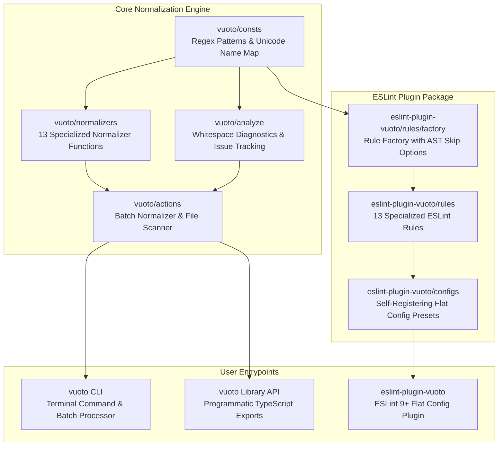

# Vuoto Architecture

## 1. Executive Summary & Philosophy

**Vuoto** is a high-performance, modular monorepo dedicated to detecting, diagnosing, and repairing invisible, ambiguous, and deceptive Unicode whitespace anomalies across modern software projects.

The project is guided by four foundational architectural principles:

1. **Native Modern Standards First**: Exclusively target modern web and tooling standards—ESLint 9+ Flat Configs, pure ECMAScript Modules (`"type": "module"`), TypeScript strict mode, and native Node.js / pnpm workflows without legacy wrappers or polyfills.
2. **Single Source of Truth (SSOT)**: Core Unicode regular expressions, code point tables, and human-readable character maps are centralized in `vuoto/consts` and consumed uniformly across the CLI, programmatic normalization engine, and `eslint-plugin-vuoto`.
3. **Defense Against Trojan Source & Code Deception**: Invisible characters (such as zero-width format characters, directionality overrides, and deceptive spaces) pose security risks and compilation pitfalls. Vuoto treats invisible whitespace as a code-quality and security concern.
4. **Infinite Composability & Zero Friction**: Every tool in Vuoto operates independently and complements the others: `vuoto` CLI for repository-wide batch processing, the programmatic API for runtime data pipelines, and `eslint-plugin-vuoto` for real-time in-editor feedback and CI enforcement.

---

## 2. Monorepo Structure & Package Topology

The repository is organized as a pnpm workspace orchestrated by **Turborepo** for build caching and topological pipeline execution.

```text
vuoto/
├── packages/
│   ├── vuoto/                 # 🧹 Core CLI & programmatic whitespace normalizer library
│   └── eslint-plugin-vuoto/   # 🎯 ESLint 9+ plugin for whitespace & Unicode normalization
├── .config/
│   └── cspell/                # Shared spellcheck custom dictionaries
├── .agents/
│   └── skills/                # AI Agent skills for developer assistants
├── .changeset/                # Changesets release orchestration & versioning
├── docs/                      # Architecture documentation & Architecture Decision Records (ADRs)
│   ├── architecture.md        # System architecture documentation
│   └── decisions/             # Architecture Decision Records (ADRs)
├── pnpm-workspace.yaml        # Workspace package mappings
└── turbo.json                 # Turborepo task pipeline configuration
```

### Dependency & Relationship Graph



---

## 3. Package Architecture & Deep Dives

### 3.1 `packages/vuoto`

- **Role**: Foundational normalization engine, diagnostic analyzer, and command-line interface.
- **Key Modules**:
  - `src/consts.ts`: Central registry defining regex patterns (`ZERO_WIDTH`, `BYTE_ORDER_MARK`, `NON_BREAKING_SPACE`, etc.), default file ignore globs, and the `UNICODE_NAME_MAP`.
  - `src/normalizers/`: 13 discrete normalizer functions specializing in specific Unicode character subsets:
    - Byte Order Mark (`U+FEFF`)
    - Zero-Width characters (`U+200B`, `U+200C`, `U+200D`, `U+2060`, `U+FEFF`)
    - Invisible separators (`U+2060`, `U+FEFF`)
    - Non-breaking spaces (`U+00A0`, `U+202F`)
    - Wide spaces (`U+2002`, `U+2003`, `U+3000`)
    - Visible miscellaneous spaces (`U+2000`–`U+200A`, `U+205F`)
    - Line & paragraph separators (`U+2028`, `U+2029`)
    - Control characters (`U+000B`, `U+000C`)
  - `src/analyze.ts`: Inspection utilities (`hasWhitespaceIssues`, `findWhitespaceIssues`) reporting exact line/column coordinates, hex code points, and Unicode character names.
  - `src/actions/run-normalize.ts`: High-throughput batch processor supporting recursive directory scanning, dry-run checks (`--check`), interactive fixes (`--fix`), and real-time terminal progress reporting.
  - `src/actions/init-config.ts`: Scaffolding action creating `.vuotoignore` presets.
  - `src/helpers/`: Ignore file aggregation combining built-in patterns, `.vuotoignore`, and discovered `.gitignore` files.
  - `src/cli.ts`: Terminal CLI built with `commander`, featuring colored formatting, custom reporting tables, and exit code handling for CI integration.

### 3.2 `packages/eslint-plugin-vuoto`

- **Role**: ESLint 9+ native Flat Config plugin providing real-time lint diagnostics and auto-fixes in editors and CI pipelines.
- **Key Modules**:
  - `src/rules/factory.ts`: Generic rule factory (`createWhitespaceRule`) producing compliant ESLint rule modules. Reports precise `{ start, end }` character ranges and provides full `fixer` replacement.
  - `src/utils/ast.ts`: AST analysis helper (`shouldSkipMatch`) allowing selective bypasses inside comments, string literals, template literals, and JSX text.
  - `src/configs/index.ts`: Four pre-configured flat config presets (`recommended`, `strict`, `all`, `off`). Presets self-register `plugins: { vuoto: plugin }` so consumers can directly spread them in `eslint.config.js`.
  - `src/utils/package-meta.ts`: Dynamic metadata resolver extracting package name and version directly from `package.json` at startup.

---

## 4. Build, Test, & Release Pipeline

### 4.1 Build Engine: Rolldown & TypeScript

- Packages compile using **Rolldown** (`rolldown -c`), delivering ultra-fast bundling of ECMAScript modules.
- Type definitions (`.d.ts`) and source maps are generated concurrently via `tsc -p tsconfig.json`.
- Test suites reside in dedicated root-level `__tests__/` folders, preventing test typings from polluting production `dist/` outputs.

### 4.2 Monorepo Task Orchestration: Turborepo

Turborepo coordinates dependencies and parallel execution across the workspace:

```json
{
  "$schema": "https://turbo.build/schema.json",
  "tasks": {
    "build": {
      "dependsOn": ["^build"],
      "outputs": ["dist/**"]
    },
    "lint": {},
    "test": {},
    "release": {
      "dependsOn": ["build"],
      "cache": false
    }
  }
}
```

- `dependsOn: ["^build"]` guarantees that `vuoto` is built before `eslint-plugin-vuoto` compiles against its workspace export.
- `turbo run release` invokes each package's `release` script with fresh compilation and zero caching.

### 4.3 Versioning & Publishing: Changesets

- Versioning and changelog management are automated with `@changesets/cli`.
- Conventional Commits are mapped into release entries using `changeset-conventional-commits`.
- Publishing workflow:
  1. `pnpm run changeset` / `pnpm run changeset:conventional` to register changesets.
  2. `pnpm run version` (`changeset version`) to bump versions and update changelogs.
  3. `pnpm run release` (`turbo run release`) to publish packages to npm.
  4. `pnpm run publish` executes `version` and `release` in a single command.

---

## 5. Quality Assurance & Git Automation

- **Pre-commit Automation**: Managed by **Lefthook** (`lefthook.yml`). Automatically lints, formats, and spellchecks staged files before commits are recorded.
- **Commit-msg Validation**: Enforces Conventional Commits rules via `@commitlint/cli` and `commitlint-config-spellbookx`.
- **Unit Testing**: Vitest runs comprehensive unit tests across `packages/vuoto/__tests__/` and `packages/eslint-plugin-vuoto/__tests__/`, verifying normalizer output, CLI flags, rule options, and flat configs.
